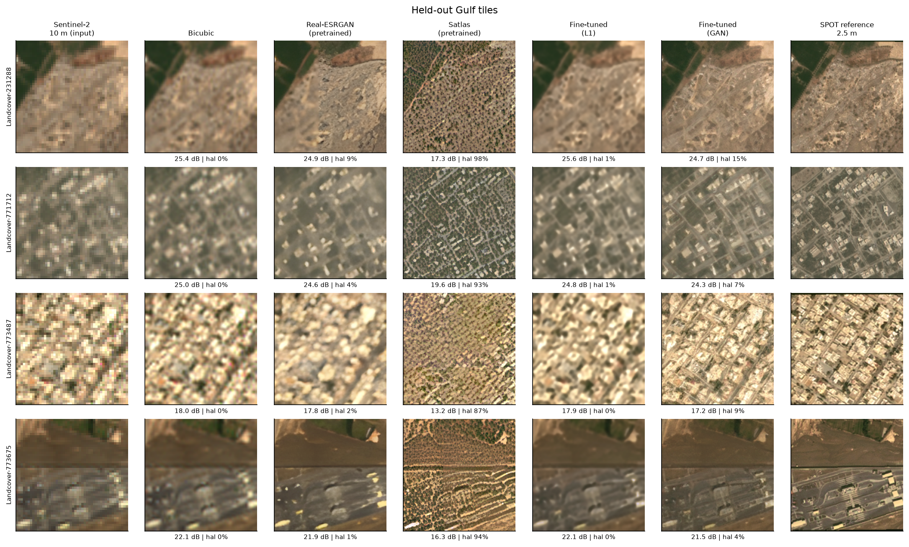
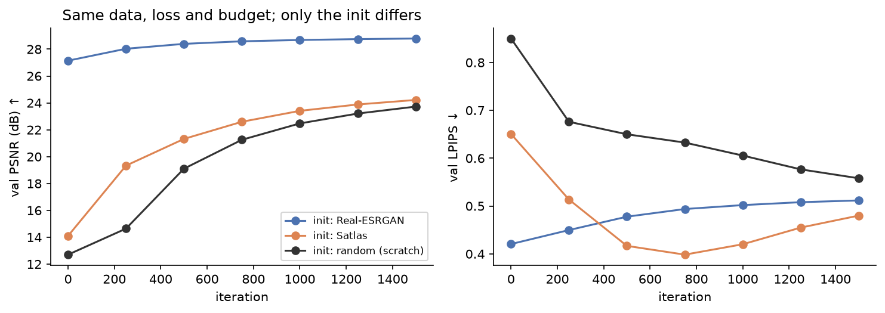
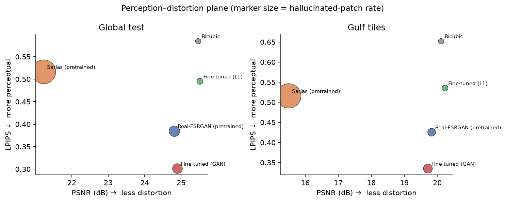
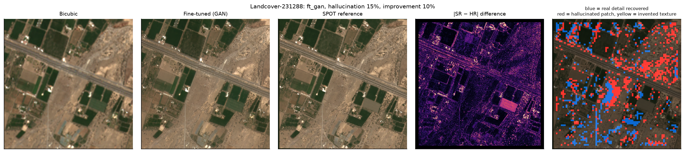
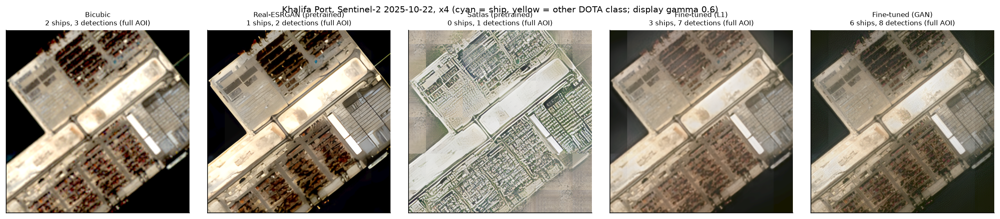
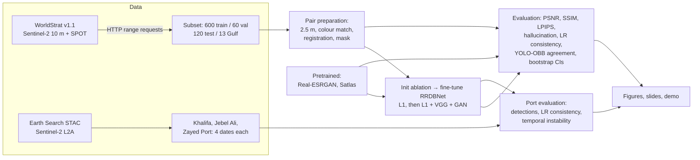

# Super-Resolution for Port Intelligence

Can deep-learning super-resolution turn free 10 m Sentinel-2 imagery into 2.5 m imagery that actually helps someone monitor Gulf ports? And how much of the "detail" it adds is real?

**Short answer:** a fidelity-trained model (L1) is reliable but only slightly better than bicubic (+0.11 dB on held-out Gulf tiles, statistically significant). A GAN-trained model looks much sharper (LPIPS 0.33 vs 0.65) and helps a detector find more of the real vessels at port berths, but it invents structure in about 7 % of patches. A satellite-specific model trained only on the US (Satlas) fails badly in the Gulf (76 % of patches hallucinated). **The training domain matters more than the architecture, and SR texture must never be treated as evidence.**



---

## Contents
1. [Problem](#1-problem)
2. [Research](#2-research)
3. [Model choices](#3-model-choices)
4. [Build vs reuse](#4-build-vs-reuse)
5. [Data](#5-data)
6. [Results](#6-results)
7. [Limitations](#7-limitations)
8. [AI usage](#8-ai-usage)
9. [Pipeline](#9-pipeline)
10. [Setup and how to run](#10-setup-and-how-to-run)
11. [Repository layout](#11-repository-layout)

Data sources, licences and how to re-create the data: [`data/README.md`](data/README.md). Slides: [`presentation/Super-Resolution_for_Port_Intelligence.pptx`](presentation/Super-Resolution_for_Port_Intelligence.pptx).

---

## 1. Problem

Sentinel-2 is free, global and revisits every 5 days, but at 10 m a container ship is a few dozen pixels and a tug is a smudge. Commercial very-high-resolution imagery solves that but is expensive and infrequent. Super-resolution (SR) promises "free 2.5 m", but generative models can paint plausible details that are not there, which is dangerous for an analyst.

So the project asks three questions, each with a measurement:

| Question | How it is measured |
|---|---|
| Is the SR image **closer to reality**? | PSNR, SSIM, LPIPS against a real 2.5 m reference (SPOT, WorldStrat) |
| How much does it **invent**? | Patch-level hallucination rate (simplified from ESA OpenSR-test), invented-detail rate, consistency with the 10 m input, temporal instability at the ports |
| Is it **useful**? | A frozen, independent detector (YOLO11m-OBB trained on DOTA) run on SR vs on the real reference; ship/harbour/tank counts at three UAE ports |

Target area: the Arabian Gulf, specifically Khalifa Port, Jebel Ali and Zayed Port (UAE).

## 2. Research

Before building, I read the original papers, documentation and repositories for every model, dataset and metric used (sources in the acknowledgements below). The points that shaped the design:

- **Sentinel-2 RGB is 10 m**; ×4 SR to 2.5 m is the community standard (OpenSR, Satlas, WorldStrat benchmarks).
- **Single-image vs multi-image SR:** multi-image SR uses several revisits but needs careful co-registration and cloud masking; single-image SR is simpler and directly comparable with the pretrained models I wanted to test. I chose single-image ×4.
- **SRGAN → ESRGAN → Real-ESRGAN:** the RRDBNet generator is the de-facto backbone; Real-ESRGAN adds realistic degradations. Satlas (Allen AI) uses the same generator trained on Sentinel-2 → NAIP (US aerial).
- **WorldStrat** (NeurIPS 2022) provides real Sentinel-2 / SPOT pairs, stratified by land use, globally, including the Gulf.
- **Metrics disagree by design:** the perception-distortion trade-off (Blau & Michaeli 2018) means no model can be best on both PSNR and LPIPS, so both must be reported.
- **Hallucination** is the main risk of GAN SR for remote sensing; ESA's OpenSR-test proposes measuring it per patch relative to both the input and the reference.
- **Task-based evaluation** (does a detector work better on SR?) is more meaningful than pixel metrics for an intelligence use case.

## 3. Model choices

| Method | What it is | Why it is included |
|---|---|---|
| Bicubic | Interpolation | Honest baseline: invents nothing |
| Real-ESRGAN x4plus | RRDBNet, generic photos, pretrained | Strong generic SR; tests "does photo SR transfer to satellites?" |
| Satlas `esrgan_1S2` | RRDBNet, Sentinel-2 → NAIP (US), pretrained | Satellite-specific; tests "does US satellite SR transfer to the Gulf?" |
| **Fine-tuned L1** (mine) | Real-ESRGAN weights fine-tuned on WorldStrat with L1 loss | Fidelity end of the perception-distortion curve |
| **Fine-tuned GAN** (mine) | Fine-tuned L1 model + VGG perceptual + adversarial loss | Perceptual end of the curve: how much realism, at what cost |

All four learned models share **the same RRDBNet architecture** (23 blocks, 16.7 M parameters). That makes the comparison controlled: differences come from training data and loss, not architecture.

The initialisation for fine-tuning was **chosen by experiment**, not assumed: three identical 1,500-iteration L1 runs from Real-ESRGAN, Satlas and random weights reached 28.79, 24.22 and 23.73 dB validation PSNR. Real-ESRGAN won.



## 4. Build vs reuse

| Reused | Built |
|---|---|
| Pretrained weights: Real-ESRGAN, Real-ESRGAN discriminator, Satlas, YOLO11m-OBB (DOTA) | RRDBNet and U-Net discriminator re-implemented in `src/srlib.py` / `src/train.py` (strict key matching to load the official weights, no heavy dependency on BasicSR) |
| WorldStrat dataset, Sentinel-2 via Element 84 Earth Search | Range-request downloader that reads only the needed files out of the 104 GB WorldStrat zips (`src/remote_zip.py`) |
| Standard metrics (PSNR, SSIM, LPIPS) | Pair preparation: colour matching, sub-pixel registration, validity masks |
| | Hallucination metrics, LR-consistency, temporal instability, detector-agreement evaluation, paired bootstrap CIs |
| | Training loop (EMA, cosine LR), evaluation, figures, Streamlit demo, slide builder |

Reasoning: training an SR model from scratch on a 4 GB GPU in days would lose to pretrained weights (confirmed by the ablation: random init is 5 dB behind). The value of this project is in the **adaptation and the evaluation**, so that is where the engineering went.

## 5. Data

Details and licences: [`data/README.md`](data/README.md).

- **WorldStrat v1.1** (Sentinel-2 L2A 10 m + SPOT 6/7 1.5 m, resampled to 2.5 m). Subset: 600 train tiles (1,607 LR/HR pairs using up to 3 revisits), 60 val, 120 test (official splits), plus **13 Gulf tiles** (every tile in lat 22-30 N, lon 47-58 E) that are **never used for training**.
- **Sentinel-2 L2A over the three ports**, 4 cloud-free dates each (Oct 2025 - Oct 2026), from Element 84 Earth Search (no account needed), 6 × 6 km areas defined in [`aoi/`](aoi/).
- Pre-processing: fixed linear stretch of reflectance 0-0.40 to 8 bit (chosen from Gulf percentiles: at 0.30, 12 % of Gulf pixels clipped), HR histogram-matched to the LR, phase-correlation registration, validity mask from the SPOT alpha channel.

## 6. Results

All numbers are read from `results/metrics/`. SR outputs are colour-harmonised to bicubic before scoring (as in OpenSR-test), so models are judged on geometry, not colour.

### Held-out Gulf tiles (13) and global test set (120)

| Method | PSNR ↑ Gulf / global | SSIM ↑ Gulf | LPIPS ↓ Gulf | Hallucinated patches ↓ Gulf / global | Detection F1 global |
|---|---|---|---|---|---|
| Bicubic | 20.11 / 25.46 | 0.504 | 0.653 | 0 % / 0 % | 0.41 |
| Real-ESRGAN | 19.88 / 24.90 | 0.486 | 0.438 | 3.2 % / 9.2 % | 0.30 |
| Satlas | 15.49 / 21.22 | 0.179 | 0.516 | 76.1 % / 72.5 % | 0.27 |
| **Fine-tuned L1** | **20.23 / 25.52** | **0.519** | 0.538 | 0.9 % / 0.9 % | 0.23 |
| **Fine-tuned GAN** | 19.71 / 24.89 | 0.475 | **0.334** | 6.8 % / 9.3 % | 0.43 |

Paired bootstrap (10,000 resamples, `results/metrics/bootstrap_ci.csv`):
- Fine-tuned L1 − bicubic PSNR: **+0.11 dB [0.02, 0.21]** on Gulf, **+0.06 dB [0.02, 0.09]** global. Significant, but small.
- Fine-tuned GAN − bicubic LPIPS: −0.32 [−0.36, −0.27] on Gulf (much more realistic-looking).
- Detection F1 (only 42 reference objects in 120 tiles): bicubic 0.41 [0.22, 0.56], GAN 0.43 [0.24, 0.59], L1 0.23 [0.07, 0.40]. **All intervals overlap: inconclusive.** The 13 Gulf tiles contain 10 reference objects, and no method (bicubic included) matches any of them.



### Hallucination



Red = patch moved away from both the input and the reference (hallucinated); yellow = texture where the reference is flat. Satlas fails systematically: it paints US-style vegetation and suburban texture onto Gulf desert ([`failures_satlas.png`](results/figures/failures_satlas.png)).

### Ports (no ground truth: reference-free checks, 3 ports × 4 dates)

| Method | Ships / image | All detections / image | LR consistency (dB) ↑ | Excess temporal instability ↓ |
|---|---|---|---|---|
| Bicubic | 2.75 | 46.0 | 43.2 | 0.00 |
| Real-ESRGAN | 2.25 | 45.9 | 31.3 | 0.25 |
| Satlas | 0.00 | 3.7 | 8.3 | 4.58 |
| Fine-tuned L1 | 3.42 | 46.3 | 26.7 | 0.77 |
| Fine-tuned GAN | 4.08 | 42.5 | 23.8 | 1.17 |

- The detector finds more ships on GAN output. I checked every ship found **only** after GAN SR: each one is a real berthed vessel visible in the 10 m input ([`port_gan_only_ships.png`](results/figures/port_gan_only_ships.png)). The deck texture the GAN paints on it cannot be verified.
- Excess temporal instability: on pixels the input says did not change between two dates, the GAN output still changes by 1.17 grey levels more than bicubic does. That is generated detail, measured without any reference.



### What worked, what did not
- **Worked:** fine-tuning on real pairs (ablation: +5 dB over random init on the same budget); EMA + cosine LR (removed ±4 dB validation swings); 24 px tile overlap (removed tile seams over water).
- **Did not work:** Satlas in the Gulf (domain shift); fp16 training on the GTX 1650 (NaN losses, switched to fp32); 8 px overlap (seams); the WorldStrat detection test (too few objects to decide anything).

## 7. Limitations

- **Small gains, small Gulf test set.** 13 Gulf tiles is what WorldStrat has in the region; the confidence intervals are reported for that reason.
- **Reference is imperfect.** SPOT and Sentinel-2 are acquired on different days and angles; residual mis-registration and real change (e.g. a replanted field) get counted as hallucination.
- **No ground truth at the ports.** Port results are reference-free (consistency, stability, detection counts), not accuracy.
- **Detector is a proxy.** YOLO11m-OBB was trained on aerial DOTA imagery, not on 2.5 m satellite SR; detection on WorldStrat is underpowered.
- **RGB only, ×4 only, single-image.** NIR/SWIR bands and multi-image SR were out of scope on a 4 GB GPU.
- **Compute.** GTX 1650 (4 GB): batch 4-8, 4,000 + 3,000 fine-tuning iterations. Longer training would likely help the GAN.
- **Licence.** SPOT imagery in WorldStrat is CC BY-NC 4.0: this work is non-commercial research.

## 8. AI usage

I used an AI coding assistant throughout this project, and I want to be explicit about where:
- **Research:** finding and summarising papers and documentation (WorldStrat, Real-ESRGAN, Satlas, OpenSR-test, DOTA). I checked every claim against the original sources.
- **Code:** drafting scripts (downloader, training loop, evaluation, figures, demo, slide builder) and debugging (fp16 NaNs, memory exhaustion, tile seams, PowerShell log encoding).
- **Writing:** drafting documentation and slide text.

What I did not delegate: every number in this repository comes from running the code on this machine, and the failures are reported as they happened (section 6, "What worked, what did not"). The design choices (held-out Gulf set, frozen independent detector, hallucination metrics, initialisation ablation, bootstrap CIs) were each checked against the results before being kept.

## 9. Pipeline



```
Sentinel-2 10 m ─► 8-bit RGB ─► [ Bicubic | Real-ESRGAN | Satlas | Fine-tuned L1 | Fine-tuned GAN ] ─► 2.5 m
                                                                                         │
SPOT ─► 2.5 m ─► colour-match ─► register ─► mask ─► reference ─────────────────────────┤
                                                                                         ▼
                    pixel metrics + hallucination maps + detector agreement + port checks
```

## 10. Setup and how to run

Tested on Windows 11, Python 3.11, NVIDIA GTX 1650 (4 GB), CUDA 12.1.

```bash
python -m venv .venv
.venv\Scripts\activate
pip install --index-url https://download.pytorch.org/whl/cu121 torch==2.5.1+cu121 torchvision==0.20.1+cu121
pip install -r requirements.txt
```

Weights (put in `weights/`): see [`data/README.md`](data/README.md) for the exact URLs (Real-ESRGAN generator and discriminator, Satlas `esrgan_1S2`, `yolo11m-obb.pt`, downloaded by Ultralytics and moved to `weights/`).

```bash
# 1. Data (needs internet; ~3 GB)
python src/download_worldstrat.py --n-train 600 --n-val 60 --n-test 120
python src/prepare_pairs.py
python src/fetch_s2_ports.py

# 2. Everything else, offline and sequential:
#    init ablation -> fine-tune L1 -> fine-tune GAN -> evaluation -> ports -> figures -> slides
python src/run_all.py          # or: powershell -File run_pipeline.ps1 (visible window + log)

# Re-run only the evaluation part (≈2.5 h on a GTX 1650)
powershell -File run_eval.ps1

# 3. Demo (before/after slider over the ports, WorldStrat results, upload your own image)
powershell -File run_demo.ps1      # starts the demo with the project .venv

# 4. Slides (numbers read from results/metrics/*.csv)
python presentation/build_deck.py
```

Training time on the GTX 1650: ablation 3 × 27-29 min, L1 fine-tune 76 min, GAN fine-tune 56 min.

## 11. Repository layout

```
├── README.md                  this file
├── requirements.txt           pinned dependencies
├── run_pipeline.ps1           full offline pipeline in a visible window
├── run_eval.ps1               evaluation-only re-run
├── run_demo.ps1               starts the demo with the project .venv
├── aoi/                       GeoJSON areas of interest (3 UAE ports)
├── configs/                   training configs (ablation, ft_l1, ft_gan)
├── data/README.md             data sources, licences, re-creation (data itself not committed)
├── demo/app.py                Streamlit demo
├── presentation/
│   ├── build_deck.py          builds the deck from the template + results
│   ├── template_original.pptx
│   └── Super-Resolution_for_Port_Intelligence.pptx
├── results/
│   ├── figures/               all figures used in README and slides
│   ├── metrics/               per-tile metrics, summaries, bootstrap CIs, port metrics
│   └── training/              training logs (loss, validation curves)
├── src/
│   ├── remote_zip.py          HTTP range-request zip reader
│   ├── download_worldstrat.py WorldStrat subset download
│   ├── prepare_pairs.py       LR/HR pair preparation
│   ├── fetch_s2_ports.py      Sentinel-2 over the ports (Earth Search)
│   ├── srlib.py               models, tiled inference, metrics
│   ├── train.py               fine-tuning (L1 / GAN)
│   ├── run_all.py             offline orchestrator
│   ├── evaluate.py            WorldStrat evaluation
│   ├── eval_ports.py          reference-free port evaluation
│   ├── stats.py               paired bootstrap CIs
│   └── make_figures.py        figures
└── weights/                   model weights (not committed)
```

## Acknowledgements and licences
WorldStrat (Cornebise et al. 2022; SPOT imagery CC BY-NC 4.0, Sentinel-2 CC BY 4.0). Sentinel-2 data: Copernicus, via Element 84 Earth Search. Real-ESRGAN (Wang et al. 2021, BSD-3). Satlas super-resolution (Allen Institute for AI, Apache-2.0). YOLO11 (Ultralytics, AGPL-3.0). DOTA (Xia et al. 2018).
